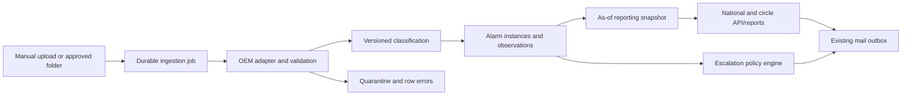

# Alarm Monitoring backend implementation roadmap

Planning date: 16 November 2026, Asia/Kolkata.

Basis: the customer Alarm Monitoring BRD, its three embedded spreadsheets,
`alarm-monitoring-gap-analysis.md`, and the current Java backend. This document is
a proposed delivery plan; its new modules, tables and APIs are not implemented
merely because they appear here. No migrations, customer imports, jobs or emails
were run while preparing it.

Implementation update: the first read-only alarm contract preview API and synthetic
fixtures are now implemented. See [delivered increment and API usage](alarm-import-preview.md).
Tenant-owned Zone/Circle master data, aliases and source-feed configuration APIs are
also implemented; see [master-data increment](alarm-master-data.md). Applying migration
008 to the deployment database and supplying approved mappings remain deployment/data
steps. The bounded durable snapshot workflow, explicit catalogue/site configuration,
comparisons, reports, mail/escalation outbox, folder/schedule controls and portal
workspace are now implemented. See [delivery guide and precise remaining boundaries](alarm-workflow-delivery.md).
Native delta/clear lifecycle, operational MS2/LR inputs, customer data/configuration,
large-volume validation and final production UAT remain pending.

## 1. Scope and architecture

Deliver native OEM alarm processing for 2G/4G, customer classification/inclusion,
reconciliation across dumps, national/zone/circle dashboards, scoped automatic
email and policy-driven escalation. Retain the current KPI/RCA/map capabilities;
their numeric threshold alarms remain a separate domain from native OSS alarms.

Use the existing Spring Boot/MySQL application as a modular monolith. Keep feature
boundaries and interfaces clear; separate deployment services only when measured
load, availability or independent ownership makes that necessary. Do not add a
broker, distributed cache or alternate database just to call the design scalable.

Suggested new feature boundaries: `alarm.ingestion`, `alarm.normalization`,
`alarm.catalog`, `alarm.lifecycle`, `alarm.reporting`, `alarm.delivery`,
`alarm.escalation`. Existing flat packages do not need a wholesale rewrite first.
Controllers validate requests/authorization; domain services implement decisions;
repositories persist state; adapters decode vendor input; workers run durable jobs.

## 2. Reuse versus build

| Existing component | Reuse | Alarm-specific work |
| --- | --- | --- |
| Company, authentication and role authorization | Tenant identity and access foundation | Zone/circle/site master and circle permissions where required |
| ParserService and uploaded alarm browsing | CSV/Excel reading, preview, initial aliases, display | Explicit OEM/sheet schemas, source timezone and complete normalized records |
| KpiIngestionService and snapshot patterns | Job ledger, immutable staged sources, bounded work, duplicate/recovery concepts | Alarm feed identity, completeness and snapshot/delta reconciliation |
| BackgroundJobConfig | Bounded executors and explicit queue rejection | Dedicated alarm job budgets, claim/recovery semantics |
| KpiAlarmService | Existing generated KPI alarm functionality | Keep it separate; native alarms need their own identity/lifecycle |
| CommonReportService/renderers | Persisted report jobs and artifact patterns | Customer national/circle templates and counts |
| ReportMailOutboxService/transport | CAPTURE/SMTP, per-recipient audit, retries and uncertain-send handling | Routing by national/circle scope and escalation event |
| NightlyWorkflowService | Durable orchestration and deadline/recovery concepts | Customer-agreed alarm cadence; not a copy of the KPI overnight timetable |

## 3. Ordered implementation phases

### Phase 0 — agree the data contract and acceptance fixtures

**Build:** a BRD traceability matrix and versioned fixture/expected-output set.
Start with the mixed Nokia/Ericsson/ZTE/Huawei/Samsung records already present in
the national workbook's hidden sheets and the supplied 2G sample. Ask for further
native exports only to validate missing layouts/cases or clarify completeness.
Confirm native formats for each OEM/RAT; snapshot versus delta semantics; severity,
inclusion and service-affecting catalogue; site inventory; circle aliases; input
cadence/timezone; ageing buckets; report columns and recipient/escalation policies.

**Why:** correct code cannot reconstruct missing business definitions from sample
formatting. MS2/LR pending and circle remarks may require separate authoritative
inputs. Resolve hardcoded COUNTIFS offsets, external links and contradictory ageing
labels in the supplied workbooks before reproducing them as logic.

**Exit:** at least one representative OEM fixture has agreed raw input, report
as-of time, classifications, distinct site/alarm counts and expected report output.
Unapproved assumptions are explicitly marked draft; no hidden default severity.

### Phase 1 — master data, tenancy and safe migrations

**Build:** Company→Zone→Circle→Site associations, OEM/RAT identifiers, source-feed
profiles and circle aliases. Preserve native BSC/BTS/TRX and MRBTS/eNodeB identifiers
and map them to the correct physical site. Add versioned SQL migrations through
the repository's chosen migration process, including an existing-database baseline.

**Why:** Company is the tenant, not a substitute for Circle. A customer contact
email is not a national/circle routing policy. Existing tables/data must survive
deployment and upgrade; do not modify production schema by trial and error.

**Exit:** aliases resolve deterministically, ambiguous sites are reported, and
tenant A cannot retrieve tenant B's files, sites, jobs or reports. A clean install
and an upgrade of an existing database both pass in isolated test databases.

### Phase 2 — normalized alarm model and versioned catalogue

**Build:** raw provenance plus canonical records, customer severity/inclusion rules
and a classification preview. Preserve source severity separately from customer
severity. Match by OEM/RAT/code and additional text/object conditions when needed;
rule precedence and effective versions must be explicit.

**Why:** the same alarm number can represent different situations. Missing rules
must be visible as unmapped, not silently assigned Major or omitted from reports.

**Exit:** supplied examples classify correctly, unknown/conflicting rules produce
reviewable outcomes, and every classified row can explain which rule version won.

### Phase 3 — durable, bounded alarm ingestion

**Build:** staged immutable file, checksum, upload/feed metadata, parser adapter,
sheet selection, validation errors, bulk inserts and job progress. Start with the
customer's Nokia examples, then introduce other OEM adapters behind the same
normalized output contract. Treat raw, derived and summary sheets explicitly.

Suggested state machine:
`RECEIVED → STAGED → VALIDATING → IMPORTING → COMPLETED / PARTIAL / FAILED`.
Only snapshots meeting the approved completeness policy may reconcile live state.

**Why:** a failed/repeated upload must not publish half an alarm inventory, consume
unbounded memory or inflate counts. An API should return a durable job ID rather
than block while a large workbook is processed.

**Exit:** repeated submission of the same import is idempotent; corrupt/oversized
files have actionable errors; restart recovery is explicit; per-job and total
worker limits are enforced; rejected work is not silently discarded.

### Phase 4 — alarm lifecycle and snapshot reconciliation

**Build:** stable alarm instances, timestamped observations, state events,
first/last-seen times and clear/reopen handling. Prefer a vendor instance ID when
available. Otherwise agree a vendor-specific identity from tenant, source, managed
object, alarm code and required occurrence attributes. Mutable severity/remarks
must not accidentally create another identity.

Distinguish full snapshots, scoped/partial snapshots and delta events. Publish
current state only in approved source-time order. Older arrivals can be stored for
audit but must not silently roll current state backwards. Corrections need an
explicit revision/rebuild policy.

**Why:** a missing row in an incomplete dump is not proof an alarm cleared.
Acknowledgement is an operator action and is not the same as OSS resolution.

**Exit:** repeat, clear, reopen, late-file, duplicate-object and partial-feed cases
pass. Counts use current unique instances, not every historical observation.

### Phase 5 — ageing, operational semantics and aggregation

**Build:** approved site-down and service-alarm buckets evaluated at a fixed UTC
instant with a documented display/source timezone. Join approved inventory and
MS2/LR/remark sources. Compute unique alarm counts separately from physical site
and technology-specific site-down counts.

**Why:** historical reports must not change just because wall-clock time advances.
No active alarm does not automatically prove a site is up: that requires agreed
inventory and feed-completeness semantics. Unknown state must remain visible.

**Exit:** bucket boundaries are tested exactly; multi-alarm sites are not counted
multiple times as down sites; scoped totals reconcile with the national total and
visible exceptions; historical as-of results are reproducible.

### Phase 6 — dashboard APIs and exact customer reports

**Build:** national→zone→circle→site→alarm drill-down APIs, severity/age/OEM/RAT
filters, pagination, sorting, search and source freshness. Render national and
circle workbooks/HTML using the approved templates. Include input snapshot IDs,
as-of timestamp, catalogue/master versions and data-quality status.

Create persisted report snapshots; render frozen results instead of rerunning a
changing live query for each download/email. Make partial/incomplete outputs
explicit, with an approved policy for whether they may be distributed.

**Exit:** expected template counts match details; pagination never changes totals;
an emailed attachment and its portal download represent the same snapshot; large
exports are jobs rather than timeout-prone requests.

### Phase 7 — national/circle recipient routing

**Build:** tenant/scoped routing rules, reviewed To/CC/BCC settings, versioned email
subject/body templates and reports per recipient scope. Integrate the existing
mail outbox. Start in CAPTURE mode; enable real transport only for approved settings.

**Why:** a correct report sent to the wrong circle is still an incorrect delivery.
Transport acceptance is not proof of inbox delivery. A timeout after SMTP handoff
must remain UNKNOWN until reconciled; blind resend risks duplicates.

**Exit:** each recipient receives only the allowed scope; retry/restart does not
duplicate successful sends; recipient/template changes are auditable; captured
content matches the approved customer format.

### Phase 8 — policy-driven escalation

**Build:** policies by severity/category/circle/OEM as approved, elapsed-age or
missed-update triggers, stages, repeat intervals, recipients and stop/reopen rules.
Persist escalation decisions and send them through the same outbox. Use unique
business-event keys and atomic worker claims to prevent duplicate stage sends.

**Why:** a cron expression alone is not an escalation engine. Policy changes,
acknowledgement, resolution, stale source data and worker restarts affect decisions.

**Exit:** threshold-boundary, repeat suppression, acknowledgement/clear/reopen,
policy revision and concurrent-worker cases pass with a controlled test clock.
Missing/stale feeds follow an approved policy rather than manufacturing clearance.

### Phase 9 — automatic orchestration and operational recovery

**Build:** approved folder polling and complete-file detection, feed schedules and
cutoffs, persisted scheduled-run IDs, missed-run handling and restart recovery.
Record ingestion, validation, reconciliation, snapshot, render and delivery stages.
Do not run heavy work on scheduler or HTTP threads; dispatch bounded durable jobs.

**Why:** customer alarm cadence can differ from the existing 01:00–02:00 KPI job.
Folder arrival is not proof the file is finished; partial/missing sources need
clear reporting. Multiple application processes must not create duplicate runs.

**Exit:** application-closed/backend-service-running, machine restart, missed input,
late input, full queue and SMTP outage scenarios have predictable audited outcomes.
Delivery-deadline reporting distinguishes requested, rendered, accepted and unknown.

### Phase 10 — performance, reliability and security hardening

Do this throughout the phases, then validate the integrated system:

- Batch writes, server-side aggregates and bounded-memory parsing; avoid loading
  all historical alarms to serve one page or dashboard.
- Tenant/scope-leading indexes on actual filter/query paths, confirmed with query
  plans and representative data. Indexes have write/storage cost; add by evidence.
- Immutable historical snapshots and explicit cache invalidation on source/rule
  changes. Share only the correctly scoped/versioned cache values.
- Authorization on every read, download and job lookup; restrict administrative
  mutations. Capture the authorized tenant explicitly for background jobs.
- File size/type/path limits, secure staging and spreadsheet-formula-safe exports;
  no arbitrary customer-supplied server paths or execution of embedded content.
- Structured logs with run IDs, health checks, queue saturation, rejection/retry
  counters, source freshness and report failures; keep credentials/data out of logs.
- Backups, restore drills, retention, audit protections and migration rollback or
  forward-repair procedures approved before production deployment.
- Configure runtime secrets outside source; use restricted DB permissions and
  supported deployment controls. Do not keep a DB transaction open around Python,
  filesystem rendering or SMTP calls.

**Exit:** measured latency/throughput/memory targets pass on agreed volumes and
hardware; long-running jobs do not starve normal APIs; backup restoration works.
Do not promise a specific SLA from unmeasured development-machine results.

### Phase 11 — customer UAT and deployment/handover

**Build:** native OEM/RAT acceptance fixtures and expected national/circle/email/
escalation outputs, installation/update runbooks, configuration guide, backup and
support procedures. Run backend/scheduler as a service if processing must continue
when the UI is closed. Verify the delivery bundle starts the Java backend and
bundles required runtimes; existing desktop packaging needs alignment.

**Exit:** approved acceptance matrix passes on a clean target environment with
realistic volume; customer approves mappings, counts, recipients and escalation
behaviour; operators can recover failed jobs and restore data using the runbook.
Offline operation also requires separate handling of the current online Google
Maps integration and reachable SMTP; neither follows automatically from local DB.

## 4. Proposed schema groups

Names are illustrative and require a migration review, not immediate creation.

| Domain | Proposed records |
| --- | --- |
| Master data | `zones`, `circles`, `circle_aliases`, `sites`, `site_network_objects`, `source_feed_profiles` |
| Ingestion | `alarm_ingestion_runs`, staged file metadata/checksums, `alarm_import_errors`, `alarm_source_snapshots` |
| Classification | `alarm_catalog_rules`, rule versions and classification decisions |
| Lifecycle | `alarm_instances`, `alarm_observations`, `alarm_state_events`, operator remarks/history |
| Reporting | `alarm_report_snapshots`, snapshot totals/details or immutable artifacts, generation jobs |
| Routing | `stakeholder_routes`, email template versions; reuse mail outbox/attempt/event records |
| Escalation | `alarm_escalation_policies`, persisted decisions/stage state and linked delivery IDs |

Every business record carries tenant ownership directly or through an enforced
parent relationship. Keep raised time, source snapshot as-of time, ingestion time,
first seen and last seen distinct. Capture raw and normalized values plus schema,
adapter, catalogue and master-data versions needed for audit/reproduction.

Idempotency must respect feed semantics: tenant/source/slot or customer import ID
plus checksum/revision. The same content arriving in a genuinely new reporting
slot may be a valid new observation; globally deduplicating only by file hash can
lose last-seen history. File names alone are not durable identity either.

## 5. Draft API surface

Use the project's established versioning/authentication conventions. These are
planned endpoints, not existing routes:

| API group | Examples |
| --- | --- |
| Master/configuration | `GET/POST /api/v1/alarm-feeds`, `/circles`, `/alarm-catalog`; validate/preview changes before activation |
| Ingestion | `POST /api/v1/alarm-imports` → 202 + persisted job ID; `GET /alarm-imports/{id}`; scoped error download |
| Lifecycle | `GET /api/v1/oss-alarms`; `GET /oss-alarms/{id}/history`; authorized acknowledgement/remarks actions |
| Dashboard | `GET /api/v1/alarm-dashboard/national`, `/circles/{id}`, `/sites/{id}` with explicit as-of/snapshot scope |
| Reports | `POST /api/v1/alarm-reports`; `GET /alarm-reports/{id}` and authenticated artifact download |
| Routing | Reviewable stakeholder/template configuration; delivery history through existing outbox conventions |
| Escalation | Policy preview/configuration and scoped escalation history; worker processes due decisions |

Validate ownership server-side; a company/circle ID supplied by the browser is
not authorization. Use stable page/sort conventions and explicit errors for
invalid filters, unmapped formats, partial imports and saturated queues.

## 6. Testing and acceptance gates

| Layer | Required evidence |
| --- | --- |
| Unit | Severity precedence, identity, ageing boundaries, timezone conversion, completeness/clear policy and escalation transitions |
| Adapter contracts | Approved native exports per OEM/RAT; missing columns, aliases, sheets, duplicate rows and bad dates |
| Real MySQL integration | Migrations, tenant isolation, unique constraints, worker concurrency, job recovery, snapshot consistency and outbox claims |
| Rendering | National/circle totals and required columns match approved fixtures; spreadsheet text is not executable formula content |
| End-to-end | Raw dump→current alarms→frozen report→captured email; repeat/restart preserves counts and delivery idempotency |
| Performance | Agreed files/sites/alarms/retention on representative hardware; measure end-to-end elapsed time and resource use |
| Customer UAT | Approved counts, selected alarm catalogue, scope routing and escalation cases for each supported OEM/RAT |

Tests run on synthetic/approved fixtures and isolated databases. Do not use the
customer's live DB, mail recipients or production queues for regression testing.

## 7. First deliverable and dependency order

**Milestone A:** one approved OEM/RAT fixture, master mappings and catalogue →
repeat-safe ingestion → correct circle/national snapshot → captured report email.
Use the supplied Nokia examples as the first candidate; approval of the mapping
and expected counts is still required. Add no unapproved severity/ageing defaults.

**Milestone B:** remaining OEM/RAT adapters plus cross-dump lifecycle/ageing cases.

**Milestone C:** production stakeholder routing and escalation with restart/failure
tests, followed by customer acceptance and deployment.

Some operational safety work starts immediately even though its final acceptance
gate is later. OEM breadth and visual polish should not precede count correctness.
No reliable percentage-complete or calendar estimate should be assigned until
sample formats, rule ownership, volume and team capacity are known.

Current next release work: apply migrations 008/009 through the deployment process,
populate approved source/catalogue/routing inputs, and validate the bounded snapshot
path against customer expected outputs. The delivery guide records which later
phases still require native adapter/operational input work rather than marking the
entire BRD complete from synthetic tests alone.
